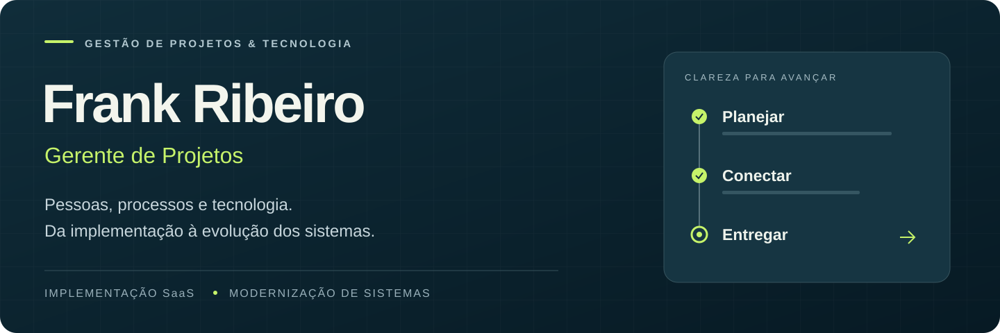

<a href="https://www.linkedin.com/in/frankribeirooficial/"><strong>Vamos conversar no LinkedIn ↗</strong></a> &nbsp; · &nbsp; <a href="#projetos-selecionados">Conheça minhas contribuições ↓</a>

## Gestão com compreensão técnica.

Sou **Frank Ribeiro, gerente de projetos na Alest Consultoria**, com atuação em **implementação SaaS e modernização de sistemas**. Minha trajetória combina gestão com experiência prática em desenvolvimento de software.

Entender como sistemas são construídos amplia minha visão sobre dependências, integrações e os desafios por trás de cada entrega.

<table>
<tr>
<td width="33%" valign="top">01 / ATUAÇÃO  <strong>Projetos de tecnologia</strong>  Implementação de soluções SaaS e modernização de sistemas.</td>
<td width="33%" valign="top">02 / PERSPECTIVA  <strong>Gestão + base técnica</strong>  Experiência prática com APIs, bancos de dados e integrações.</td>
<td width="33%" valign="top">03 / DESENVOLVIMENTO  <strong>Aprendizado contínuo</strong>  Formação complementar em gestão de projetos e Scrum.</td>
</tr>
</table>

## Projetos selecionados

Projetos acadêmicos desenvolvidos em equipe. Abaixo, as entregas em que contribuí diretamente.

<table>
<tr>
<td width="50%" valign="top">
01 / APLICAÇÃO WEB
<h3>Agenda Angélica</h3>

Organização de serviços, clientes e agendamentos.

<strong>Minha contribuição</strong> Estrutura e organização de rotas, integração Flask/PostgreSQL com Docker e melhorias nas regras de horários e na interface de agendamento.

PYTHON · FLASK · POSTGRESQL · DOCKER

<a href="https://github.com/andrepsousa/agenda_angelica"><strong>Ver projeto e contribuições ↗</strong></a>

</td>
<td width="50%" valign="top">
02 / API &amp; INTEGRAÇÕES
<h3>Gestão de Estoque</h3>

Gerenciamento de produtos e vendas para pequenos mercados.

<strong>Minha contribuição</strong> Gerenciamento e ativação de produtos por vendedor, integração com WhatsApp via Twilio, validação de CNPJ duplicado e ajustes de rotas.

PYTHON · FLASK · JWT · TWILIO

<a href="https://github.com/andrepsousa/ms-market-management"><strong>Ver projeto e contribuições ↗</strong></a>

</td>
</tr>
</table>

<strong>Formação complementar e credenciais</strong>

- Gerenciamento de Projetos com Ênfase no PMI — Da Iniciação ao Planejamento · Impacta Tecnologia.
- Scrum — Gestão e Desenvolvimento Ágil de Projetos · Impacta Tecnologia.
- Miro Essentials · Miro.
- Notion Essentials Badge · Notion.

Cursos e credenciais de aprendizagem; detalhes no [LinkedIn](https://www.linkedin.com/in/frankribeirooficial/).

 

---

<strong>Projetos conectam pessoas. Tecnologia amplia possibilidades.</strong>  <a href="https://www.linkedin.com/in/frankribeirooficial/">Experiência profissional e contato no LinkedIn ↗</a>

